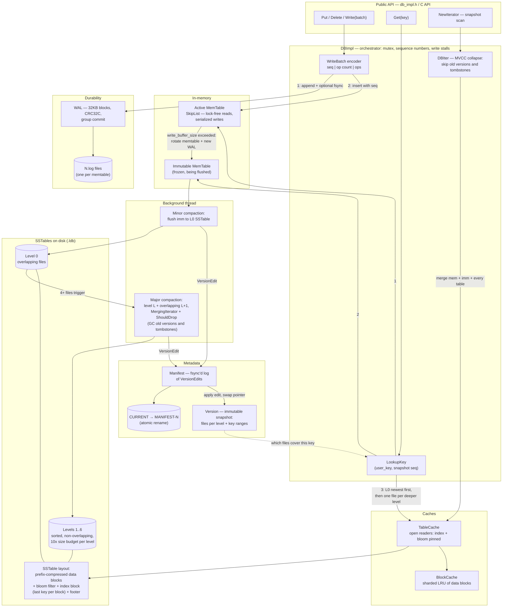
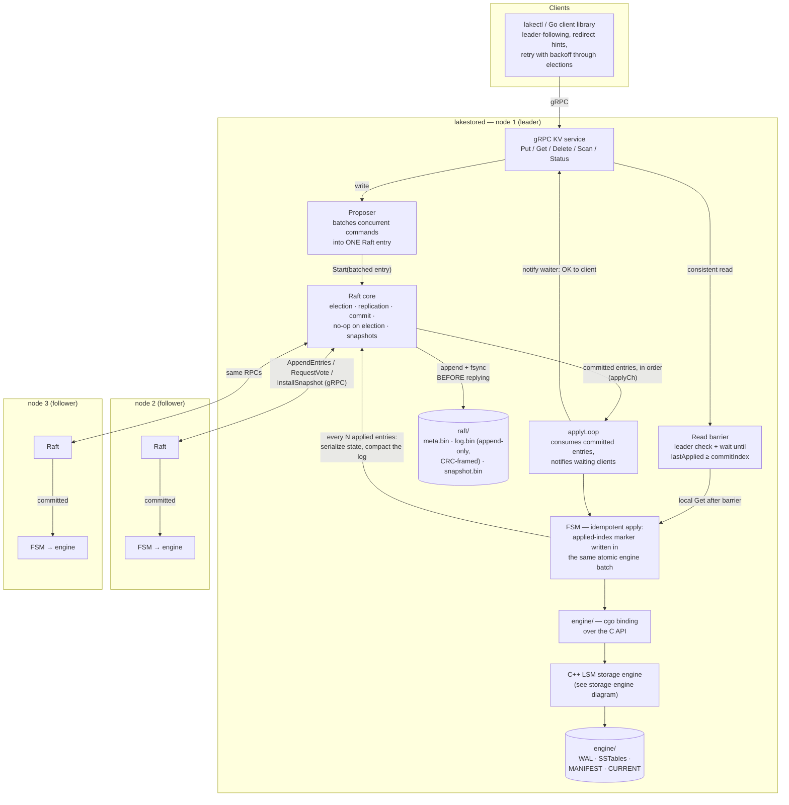

# Architecture Diagrams (Mermaid)

Render these at [mermaid.live](https://mermaid.live) to export PNG/SVG for
the README, or let GitHub render the fenced blocks directly.

## 1. Storage engine (C++ LSM-tree)

## 2. Raft + complete distributed KV store

